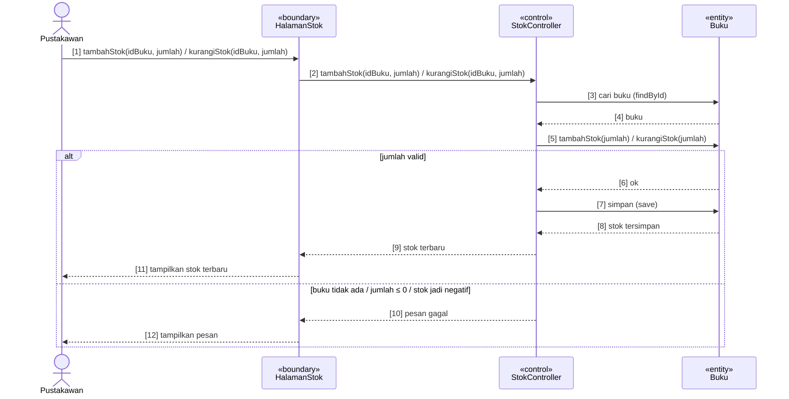
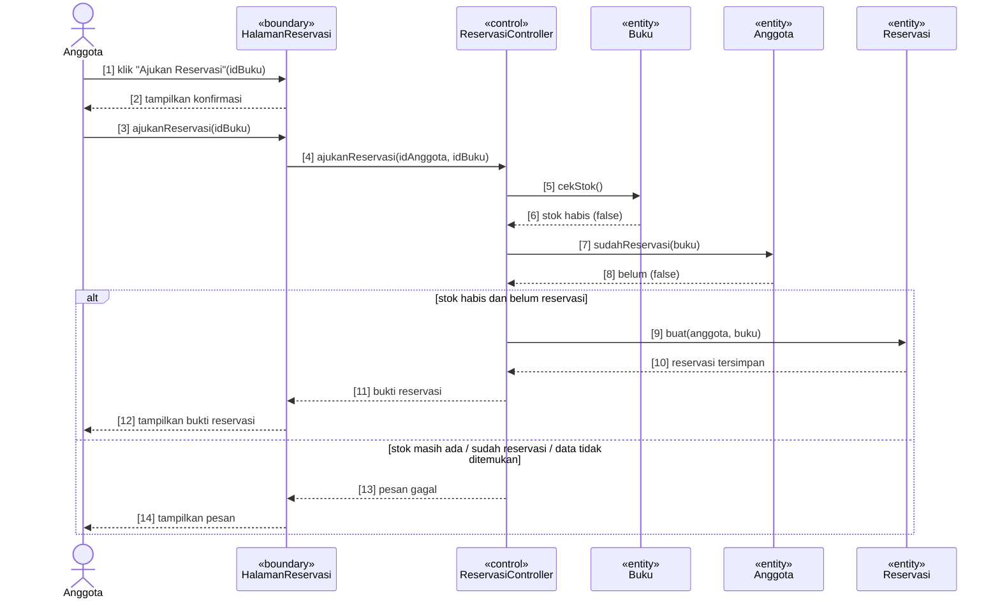

# Sequence Diagram — Latihan Implementasi BCE Perpustakaan

Nomor pesan `[n]` pada diagram sama dengan komentar `// [n]` di kode, sehingga setiap pesan dapat ditelusuri ke baris kodenya.

| Kelas desain | Stereotype | Berkas di Spring Boot |
|---|---|---|
| HalamanStok | «boundary» | `boundary/HalamanStokController.java`, `templates/stok.html` |
| StokController | «control» | `control/StokService.java` |
| HalamanReservasi | «boundary» | `boundary/HalamanReservasiController.java`, `templates/reservasi.html`, `bukti-reservasi.html` |
| ReservasiController | «control» | `control/ReservasiService.java` |
| Buku, Anggota, Reservasi | «entity» | `entity/Buku.java`, `entity/Anggota.java`, `entity/Reservasi.java` + repository |

---

## UC-02 Kelola Stok Buku (aktor: Pustakawan)

| No | Pesan | Implementasi di kode | Ditulis di |
|---|---|---|---|
| [1] | tambahStok / kurangiStok (Pustakawan → HalamanStok) | Form `POST /stok/tambah`, `POST /stok/kurangi` | `HalamanStokController` |
| [2] | tambahStok / kurangiStok (HalamanStok → StokController) | `stokService.tambahStok(idBuku, jumlah)` | `HalamanStokController` |
| [3]–[4] | cari buku | `bukuRepository.findById(idBuku)` | `StokService` |
| [5]–[6] | tambahStok(jumlah) / kurangiStok(jumlah) | `buku.tambahStok(jumlah)` / `buku.kurangiStok(jumlah)` | `StokService` → `Buku` |
| [7]–[8] | simpan | `bukuRepository.save(buku)` | `StokService` |
| [9] | stok terbaru | `return buku` | `StokService` |
| [10] | pesan gagal | `throw new StokGagalException(...)` | `StokService` |
| [11] | tampilkan stok terbaru | flash `pesanSukses` → `redirect:/stok` | `HalamanStokController` |
| [12] | tampilkan pesan | flash `pesan` → `redirect:/stok` | `HalamanStokController` |

---

## UC-03 Ajukan Reservasi («extend» dari Pinjam Buku, aktor: Anggota)

Titik extend: pesan **[14] tampilkan pesan & opsi reservasi** pada UC-01 Pinjam Buku saat stok habis.

| No | Pesan | Implementasi di kode | Ditulis di |
|---|---|---|---|
| [1] | klik "Ajukan Reservasi" | Tautan `GET /reservasi?idBuku=..` di `pinjam.html` | `HalamanReservasiController` |
| [2] | tampilkan konfirmasi | `reservasiService.cariBuku(idBuku)` → `reservasi.html` | `HalamanReservasiController` |
| [3] | ajukanReservasi(idBuku) | Form `POST /reservasi` | `HalamanReservasiController` |
| [4] | ajukanReservasi(idAnggota, idBuku) | `reservasiService.ajukanReservasi(idAnggota, idBuku)` | `HalamanReservasiController` |
| [5]–[6] | cekStok() | `buku.cekStok()` | `ReservasiService` → `Buku` |
| [7]–[8] | sudahReservasi(buku) | `anggota.sudahReservasi(buku)` | `ReservasiService` → `Anggota` |
| [9]–[10] | buat(anggota, buku) + simpan | `Reservasi.buat(anggota, buku)`, `reservasiRepository.save(reservasi)` | `ReservasiService` |
| [11] | bukti reservasi | `return BuktiReservasi.dari(reservasi)` | `ReservasiService` |
| [12] | tampilkan bukti reservasi | `model bukti` → `bukti-reservasi.html` | `HalamanReservasiController` |
| [13] | pesan gagal | `throw ReservasiGagalException.stokMasihAda()` / `.sudahReservasi()` | `ReservasiService` |
| [14] | tampilkan pesan | `model pesan` → `reservasi.html` | `HalamanReservasiController` |
